  

**Bartın Üniversitesi Bilişim Sistemleri öğrencisiyim.** Swift ile macOS uygulamaları, Python ve JavaScript ile web araçları, Unity ile etkileşimli deneyimler geliştiriyorum.

[Projeleri gör](#öne-çıkan-projeler) · [E-posta](mailto:berkdurmaz41@hotmail.com)

## Öne çıkan projeler

### [OpenIsland ↗](https://github.com/BerkDrmz/OpenIsland)

MacBook ekranının üst kısmında medya kontrollerini, Pomodoro’yu, dosya rafını ve Dock pencere önizlemelerini bir araya getiren açık kaynaklı macOS uygulaması.

`Swift` · `AppKit` · `Core Animation`

### [MacRAR Plus ↗](https://github.com/BerkDrmz/MacRAR-Plus)

RAR, ZIP ve 7z arşivleri için yerel macOS çalışma alanı. Quick Look, Finder eylemleri ve arşivi çıkarmadan içerik arama özellikleri sunuyor.

`Swift` · `macOS` · `Quick Look`

### [UniTakip ↗](https://github.com/BerkDrmz/unitakip-public)

Üniversite ders sitelerindeki ödevleri, sınavları ve notları tek panelde toplayan kişisel takip uygulaması. Cloudflare üzerinde çalışıyor ve değişiklikleri Gmail ile bildiriyor.

`Python` · `React` · `Cloudflare Workers`

## Geliştirme alanlarım

- **Yerel uygulamalar** · Swift, AppKit, SwiftUI, C ve C++
- **Web ve veri** · TypeScript, JavaScript, Python, Java, PHP, PostgreSQL, MySQL ve REST API’leri
- **Oyun ve simülasyon** · Unity ve C#

  
Diğer çalışmalar

- [Neurocharging](https://github.com/BerkDrmz/neurocharging) · Unity denemeleri
- KPI yönetim paneli · PHP, MySQL ve JavaScript ile metrikler ve grafikler
- E-ticaret arayüzü · Sepet durumu, dinamik filtreler ve Bootstrap 5

[GitHub’daki tüm depolar](https://github.com/BerkDrmz?tab=repositories) · [Kişisel site](https://berkdrmz.com)
