<a href="https://berkdrmz.com">
<picture>
<source media="(max-width: 767px)" srcset="https://github.com/BerkDrmz/BerkDrmz/raw/main/assets/hero-mobile.svg">

</picture>
</a>

 

**Bartın Üniversitesi Bilişim Sistemleri öğrencisiyim.** Swift ile macOS uygulamaları, Python ve JavaScript ile web araçları, Unity ile etkileşimli deneyimler geliştiriyorum.

[Projeler](#öne-çıkan-projeler) · [Kişisel site ↗](https://berkdrmz.com) · [E-posta ↗](mailto:berkdurmaz41@hotmail.com)

 

## Öne çıkan projeler

<a href="https://github.com/BerkDrmz/OpenIsland">
<picture>
<source media="(max-width: 767px)" srcset="https://github.com/BerkDrmz/BerkDrmz/raw/main/assets/card-openisland-mobile.svg">

</picture>
</a>

<a href="https://github.com/BerkDrmz/MacRAR-Plus">
<picture>
<source media="(max-width: 767px)" srcset="https://github.com/BerkDrmz/BerkDrmz/raw/main/assets/card-macrar-mobile.svg">

</picture>
</a>

<a href="https://github.com/BerkDrmz/unitakip-public">
<picture>
<source media="(max-width: 767px)" srcset="https://github.com/BerkDrmz/BerkDrmz/raw/main/assets/card-unitakip-mobile.svg">

</picture>
</a>

 

## Geliştirme alanlarım

- **Yerel uygulamalar** · Swift, AppKit, SwiftUI, C ve C++
- **Web ve veri** · TypeScript, JavaScript, Python, Java, PHP, PostgreSQL, MySQL ve REST API’leri
- **Oyun ve simülasyon** · Unity ve C#

  
Diğer çalışmalar

   

- [Neurocharging](https://github.com/BerkDrmz/neurocharging) · Unity denemeleri
- KPI yönetim paneli · PHP, MySQL ve JavaScript ile metrikler ve grafikler
- E-ticaret arayüzü · Sepet durumu, dinamik filtreler ve Bootstrap 5

 

[Tüm depolar](https://github.com/BerkDrmz?tab=repositories) · [berkdrmz.com](https://berkdrmz.com)
